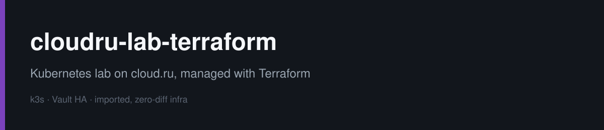
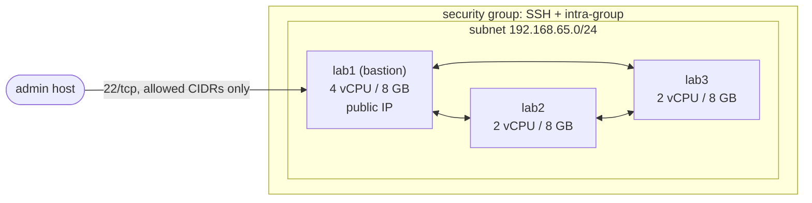

# cloudru-lab-terraform


Terraform for a small Kubernetes lab on [cloud.ru Evolution](https://cloud.ru/): one bastion with a public IP and two private nodes in one subnet.
The lab runs k3s, Vault (HA, Raft) and the [url-shortener](https://github.com/vionarion/go-projects/tree/main/url-shortener) service.

The VMs were first created by hand in the console. This repository brought them under Terraform **by import, without recreating anything**: the first `plan` after import showed `No changes`, and the cluster kept running.

## Layout

```
modules/
  network/   subnet, security group, rules (SSH from allowed CIDRs, any traffic inside the group, egress)
  vm/        boot disk, network interface, optional public IP, VM
envs/
  lab/       the lab itself: nodes are a map, one module call per node
aws-localstack/  the same approach on AWS APIs (VPC/NAT/endpoint, S3 state with lock file, IRSA), see its README
```



Adding a node is one line in `nodes`; the outputs give the bastion IP, private IPs and a ready `~/.ssh/config` block with `ProxyJump`.

## Usage

```sh
export TF_CLI_CONFIG_FILE=$PWD/.terraformrc   # cloud.ru provider mirror
export AUTH_KEY_ID=...  AUTH_SECRET=...        # service account access key

cd envs/lab
cp terraform.tfvars.example terraform.tfvars   # fill in project, VPC, image IDs, your IP
terraform init
terraform plan
```

Credentials never go into code or tfvars: the provider reads them from the environment.
`*.tfvars` and `backend.hcl` are git-ignored.

## Remote state

State is stored in a self-hosted S3 ([RustFS](https://github.com/vionarion/docker-apps/tree/main/apps/rustfs)) with a native lock file (`use_lockfile`), bucket versioning on.
cloud.ru Object Storage was the first choice, but the project's tenant was not provisioned (`NoSuchTenant`).

```bash
cd envs/lab
cp backend.hcl.example backend.hcl
export AWS_ACCESS_KEY_ID=...  AWS_SECRET_ACCESS_KEY=...   # storage key, not the cloud.ru one
terraform init -backend-config=backend.hcl
```

Checked: `init -migrate-state` moved 15 resources, `plan` shows no changes, and while a lock file exists the next run fails with `Error acquiring the state lock`.

## How the import was done

1. Listed existing resources with the provider's data sources (`compute_vm_collection`, `compute_interface_collection`, ...).
2. Wrote `import {}` blocks for 15 resources (subnet, security group and its 3 rules, public IP, 3 × interface/disk/VM)
   and ran `terraform plan -generate-config-out` once to see what the provider reads back.
3. Rewrote the generated config into the two modules, keeping the console-generated names as optional overrides,
   so new nodes get clean names (`lab-2-disk`, `lab-2-eth0`) while old ones stay untouched.
4. Iterated until `plan` showed `15 to import, 0 to add, 0 to change, 0 to destroy`, applied, removed the import blocks.

Two references in the API point both ways (VM ↔ interface, interface ↔ public IP).
The module owns one direction (VM → interface → IP) and ignores the mirrored one, so there is no dependency cycle and no perpetual diff.

## First change through Terraform: closing SSH

After the import, SSH was open to `0.0.0.0/0`. It was narrowed to the admin host in two applies, so access was never lost:

| step | `ssh_allowed_cidrs` | plan |
|------|---------------------|------|
| 1 | `0.0.0.0/0`, `admin/32` | 1 to add |
| 2 | `admin/32` | 1 to destroy |

A single apply would have destroyed the old rule first and could have locked the operator out if the create step failed.

## CI

`.github/workflows/ci.yml`, all actions pinned by commit SHA:

- `terraform fmt -check`, `init -backend=false`, `validate` for the env, both modules and the AWS lab
- `tflint` with the full Terraform ruleset
- `trivy config` (HIGH/CRITICAL fail the build)
- `gitleaks` over the whole history

## AWS

[`aws-localstack/`](aws-localstack/) applies the same ideas to AWS without an account: VPC with NAT and an S3 gateway endpoint,
remote state in S3 with native locking, and an IRSA role for the url-shortener ServiceAccount.

## Next

- `plan` on pull requests, `apply` from CI with a protected environment
- cloud-init for new nodes (user, SSH key, k3s join)
