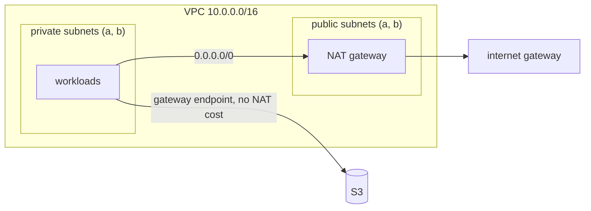

# AWS on LocalStack

The same approach as the cloud.ru lab, on AWS APIs. Runs against [LocalStack](https://github.com/localstack/localstack) 4.14
deployed in the lab k3s cluster, so no AWS account or money is needed.
Removing the `endpoints` block and fake credentials in `providers.tf` / `backend.tf` points it at a real account.

## What's inside

| file | resources |
|------|-----------|
| `main.tf` | VPC, 2 public + 2 private subnets in two AZs, internet gateway, NAT gateway, S3 gateway endpoint |
| `state_bucket.tf` | bucket for Terraform state: versioning, KMS encryption with key rotation, public access blocked |
| `backend.tf` | state in that bucket, locking with S3 lock file (`use_lockfile`, no DynamoDB, Terraform >= 1.10) |
| `irsa.tf` | EKS OIDC provider + IAM role that only one Kubernetes ServiceAccount can assume (IRSA), least-privilege policy |



## Design notes

- **S3 through a gateway endpoint, not NAT.** NAT gateway bills per GB; S3 traffic (images, backups, state) goes through a free endpoint and never leaves the AWS network.
- **One NAT for the lab.** Production gets one NAT per AZ with a route table per AZ, so losing an AZ doesn't cut egress for the other one.
- **No public IPs on launch** in public subnets: only the NAT gateway and load balancers live there, and they get their own addresses.
- **State bootstrap in two steps:** the first apply creates the bucket with local state, then `terraform init -migrate-state` moves state into it.
- **IRSA trust is pinned** to `system:serviceaccount:urls:url-shortener` and audience `sts.amazonaws.com`. A pod in another namespace, or with another ServiceAccount, gets `AccessDenied` from STS. No static keys in the cluster. EKS Pod Identity is the newer alternative.

## Usage

```sh
# LocalStack is a NodePort in the lab cluster; tunnel it through the bastion
ssh -f -N -L 4566:<lab1-private-ip>:31566 lab1

terraform init -backend=false   # first apply with local state
terraform apply
# then enable backend.tf and move the state into the bucket
terraform init -migrate-state
```

Limits of the free LocalStack: Lambda and real EC2 instances don't start (no Docker inside k3s), the APIs still answer, which is enough for networking, IAM and S3.

## Exercises

1. NAT per AZ: `count = 2`, a route table per AZ. What breaks with one NAT when its AZ goes down?
2. Run two `terraform plan` at once and watch the lock file stop the second one.
3. Change the ServiceAccount in `irsa.tf` to another namespace: why does the pod lose the role?
4. Add an interface endpoint for Secrets Manager. How is it different from a gateway endpoint?
5. Create a bucket by hand with `aws s3 mb` and bring it under Terraform with `import`.
